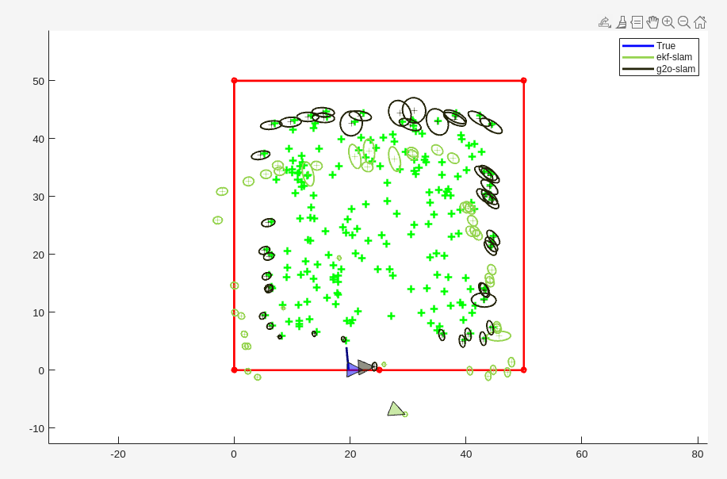
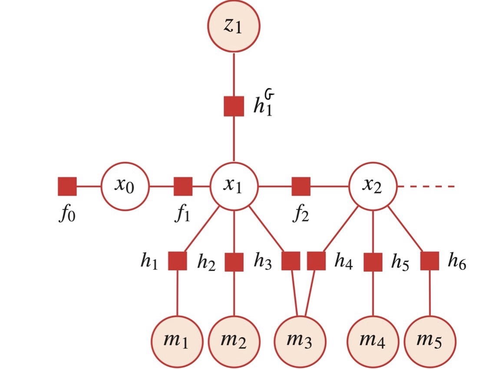
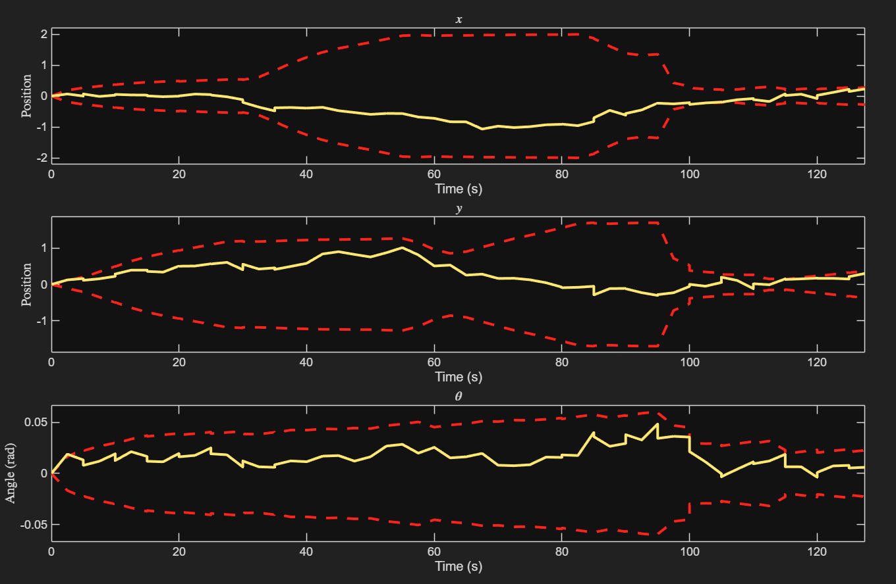
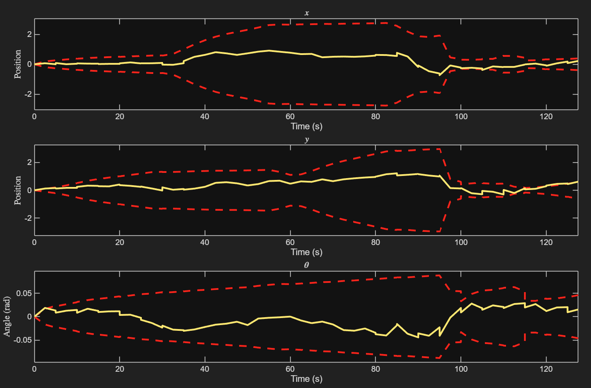
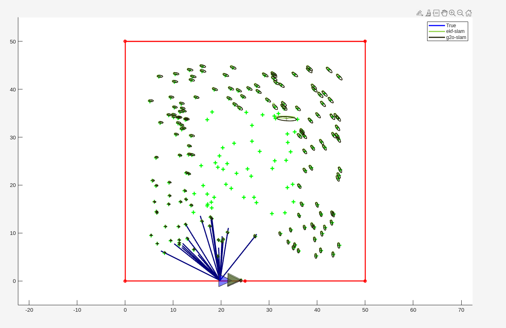
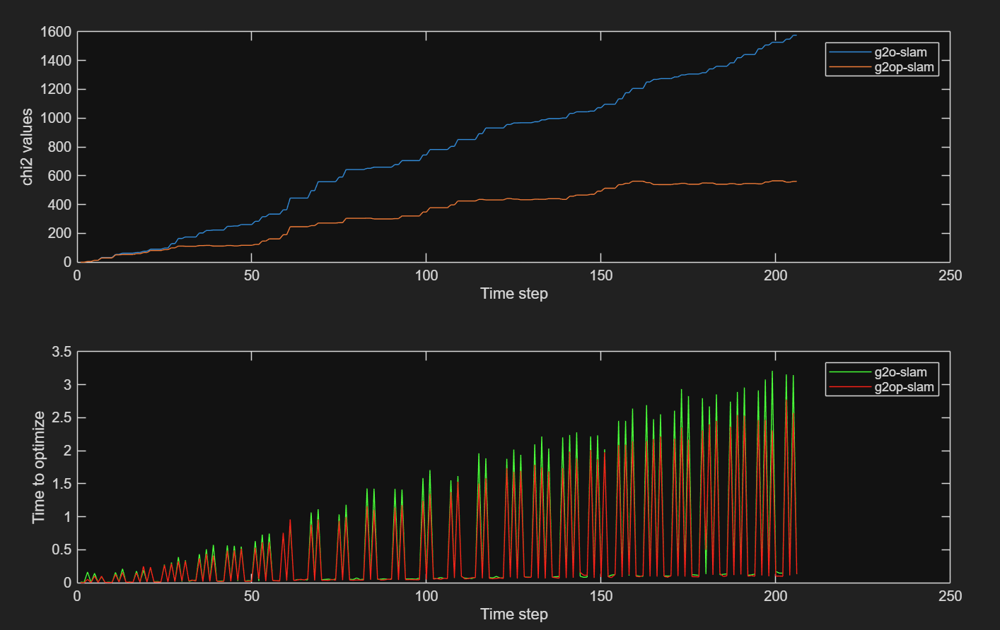

# Factor Graph SLAM with g2o

This repository contains a group project on **factor-graph SLAM** for a 2D vehicle, built in the MATLAB g2o framework of the course and compared with EKF-SLAM:

* a **GPS-aided localisation** system, with the process-model edge and its analytic Jacobians;
* **landmark SLAM** with a range–bearing edge and its Jacobians, checked against EKF-SLAM with and without noise;
* a **larger scenario**, where a short sensor range makes the EKF inconsistent but not the factor graph;
* two ways to keep the graph small: **pruning** landmark observations, and **fixing** old vertices.

The full write-up is in [report.pdf](./report.pdf). Developed as a group project for Coursework 1 of the UCL module *COMP0249: Robot Vision and Navigation* (2026).

## Repository structure

* `code/PlatformPredictionEdge.m` — the process-model edge between consecutive vehicle states: initial estimate, error and Jacobians;
* `code/LandmarkRangeBearingEdge.m` — the range–bearing observation edge between a vehicle state and a landmark: initial estimate, error and Jacobians;
* [figures](./figures/) — figures from the report;
* [report.pdf](./report.pdf) — the report.

The two edges are the files written for the coursework. The rest of the SLAM system, the simulator and the EKF baseline come from the course framework, so they are not included here.

## Built on

* the course's MATLAB coursework framework — the simulator, the EKF-SLAM baseline and a MATLAB port of [g2o](https://github.com/RainerKuemmerle/g2o) (`g2o.core`);
* [MATLAB](https://www.mathworks.com/products/matlab.html).

## Method

**Process model.** The vehicle state is x = [x, y, φ]. The edge predicts the next state as x′ = x + M(φ)(u + v), with M(φ) the rotation by φ scaled by the time step. The error is the process noise that explains two consecutive states, v = M(φ)⁻¹(x′ − x) − u, with the heading difference wrapped to [−π, π]. Both Jacobians are derived analytically. Replacing them with finite differences gave the same results.

**GPS localisation.** GPS edges are unary, so the measurements are factors and not vertices. The χ² cost of each edge is eᵀΩe, and the graph is solved by Levenberg–Marquardt with a sparse Cholesky factorisation.

**Landmark SLAM.** Landmarks are 2D vertices. The range–bearing edge initialises a new landmark by projecting the measured range along the vehicle heading plus the bearing. Its error is the measured range and bearing minus the predicted ones, with the bearing wrapped. Its Jacobians are derived analytically, with a guard for a vehicle almost on top of a landmark.

**Keeping the graph small.**

* Pruning keeps at most four observation edges per landmark.
* Fixing vertices freezes old vertices so that only a window near the vehicle is optimised, and frees them all at the last step.

## Results

* **GPS localisation.** χ² is zero until a GPS fix arrives every 60 steps, then rises in steps, and the solve time spikes with each fix. The position stayed within the 2σ bounds 80–90% of the time on most runs, with a strong dependence on the random seed.
* **Landmark SLAM.** With zero noise, g2o and EKF-SLAM give identical means and covariances, which confirms the edges. With noise, the errors stay mostly within 2σ, χ² reaches about 2200 and the solve time peaks at about 3.5 s.
* **Short sensor range.** The EKF becomes overconfident: its pose drifts and true landmarks fall outside its ellipses, while the factor graph stays consistent because it relinearises the whole past. A detection range of 14 brings the two back together.
* **Fixing vertices.** The optimisation time levels off instead of growing, but the estimate becomes overconfident and biased, and the global map is less accurate.

| Pruning | Full graph | Pruned graph | EKF |
|---|---|---|---|
| Landmark observation edges | 796 | 336 | — |
| Mean optimisation time | 0.5878 s | 0.4992 s | — |
| Mean 2σ in x, y | 1.01 m, 0.92 m | 1.34 m, 1.27 m | 0.47 m, 0.49 m |
| Errors within 2σ | yes | yes | no |

Pruning removes 58% of the observation edges and cuts the optimisation time by about 15%. The uncertainty grows, but the estimate stays consistent. The EKF reports the smallest uncertainty yet is inconsistent.

| | |
|---|---|
|  |  |
|  |  |

## Running

The edges need the course's MATLAB coursework framework. Replace the files of the same name in the framework with the two in `code/`, then run the coursework scripts from MATLAB.

## Authors

Amir Gerges, Manuel de Castro Ribeiro Jardim, Hashim and Cristhian Daniel Poveda Bravo, UCL.
